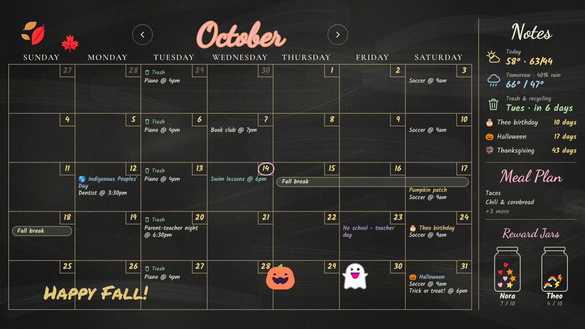
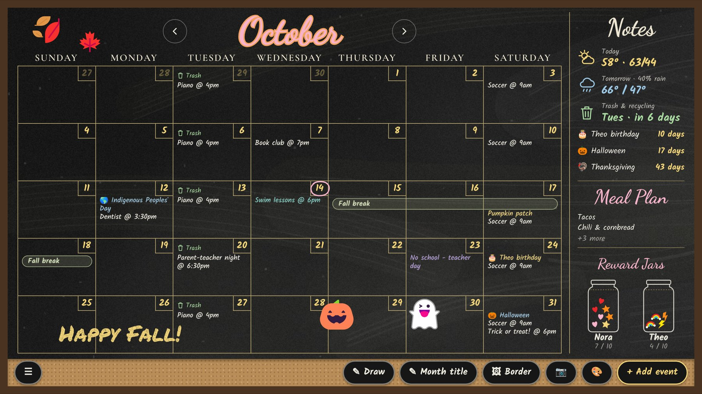
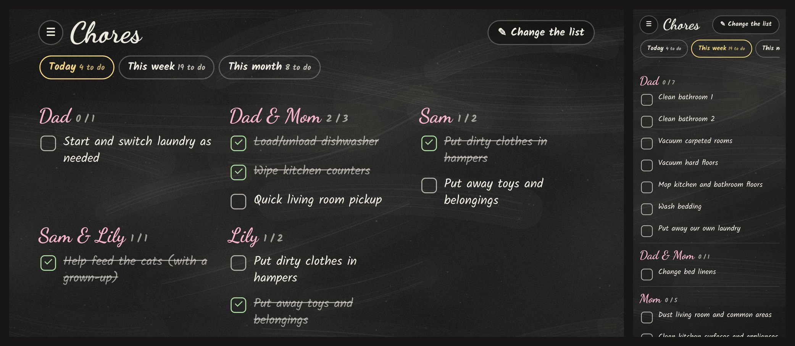
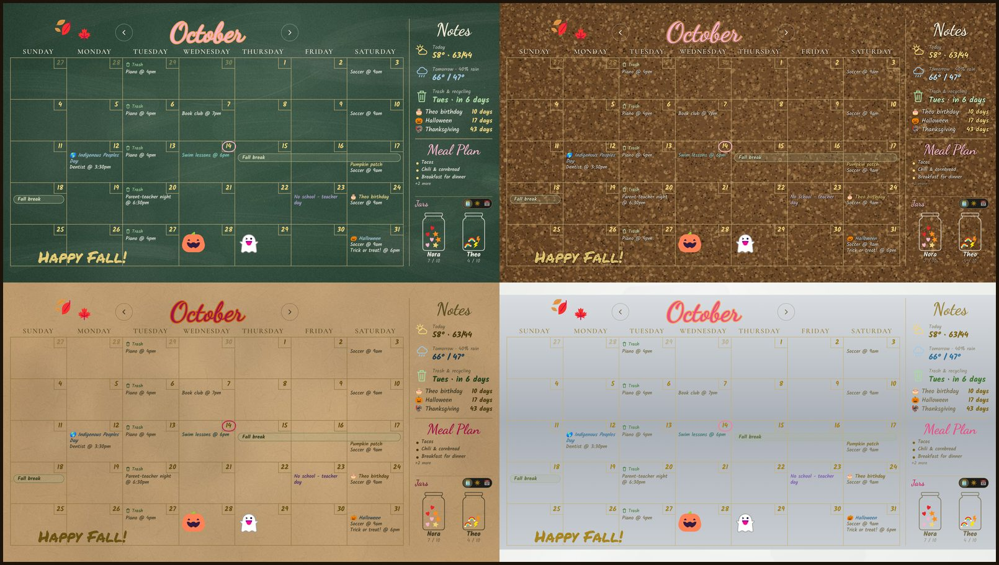
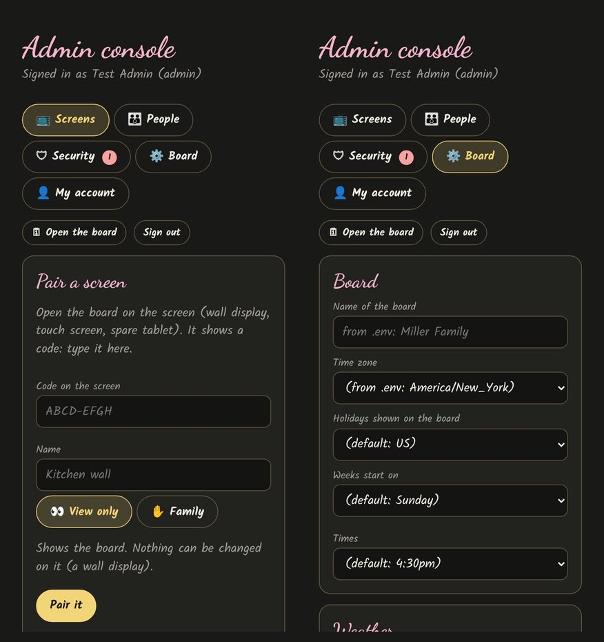

# Family Chalk Planner

A chalkboard-style family wall calendar for a wall-mounted screen, edited from a tablet.



- **Your real calendar.** Events come from Google Calendar or any CalDAV calendar (iCloud, Nextcloud, Fastmail, Radicale…); Outlook and any other calendar link show alongside, read-only ([which calendars](docs/calendars.md)). Add, edit and delete from the tablet, including repeating events ("just this one" or "all of them"), and make birthdays and big days stand out in large or extra-large writing.
- **Draw on it.** Chalk and paint-marker drawing, typed or hand-lettered month titles in 63 fonts (handwritten, regular serif and sans, chalk, script, bubbly and holiday ones), and **⭐ Pictures**: one search through about 22,000 pictures (emoji in eight styles, real clipart from Openclipart, weather and food sets, and about 3,200 chalk drawings in any color), seasonal packs (Thanksgiving, Christmas, Halloween, back to school...), Favorites, free public-domain pictures from the web when you can't find one, and GIFs (upload, or paste a link and the board keeps its own copy). The art is saved per month.
- **Holiday borders.** Jack-o'-lanterns, bats and mummies around October; pumpkins, corn and turkeys for Thanksgiving; ready-made sets for every season, or any pictures you pick. They come back every year.
- **Chores.** A family checklist for every day, week and month that resets by itself. Swipe left on the calendar to see it, tick chores off on the board or your phone, and give each kid a tablet that shows only their own.
- **A Notes column.** Weather, trash and recycling days, countdowns to holidays, birthdays and starred events, a meal plan, and kids' reward jars, today's events, an "Up next" list or a photo at the bottom, with a little switch to flip between them.
- **Photos.** Polaroids pinned beside the month name (random or hand-picked per month, or leave the space for art), and an overnight slideshow with collages framed on people's faces, all from an iCloud or Google Photos shared album.
- **More than one calendar.** Show several calendars from the same account and read-only calendar links (school, sports teams), each in its own color. A Week page shows one week at a time, with its own decorations. Weeks can start on Monday, times can be 24-hour, holidays for the US, Canada or the UK.
- **Make it yours.** Backgrounds (black, green or blue chalkboard, cork, kraft paper, whiteboard, dark wood, black glass, linen paper, pegboard, with an optional seasonal pattern), board styles (presets plus per-part fonts and colors), per-event colors, and a today marker that can be a chalk ring, circle, heart, star or box.
- **Live.** Changes made on the tablet appear on the wall within a second. The wall updates itself when you install a new version.
- **Small and private.** It runs on your own network as one Node.js service (or one Docker container) with a SQLite file. No account and no cloud service of its own; screens, fonts and pictures all come from your own server. No server at home? It also runs on a small cloud server behind a free Cloudflare Tunnel ([docs/cloud.md](docs/cloud.md)).
- **Safe for a family.** Screens are paired with a code; people sign in with a passkey or password + authenticator app; an admin console shows every sign-in, screen and change.





<p align="center"> </p>

## Install

**[Getting started](docs/getting-started.md)** walks through everything, step by step with pictures: installing, creating the admin account, connecting your calendar, putting it on the wall and inviting the family. About half an hour.

| You have | Install with |
|---|---|
| **Home Assistant** | [](https://my.home-assistant.io/redirect/supervisor_add_addon_repository/?repository_url=https%3A%2F%2Fgithub.com%2Fjoshua-d-miller%2Ffamily-chalk-planner-ha) then install **Family Chalk Planner** from the app store ([family-chalk-planner-ha](https://github.com/joshua-d-miller/family-chalk-planner-ha)). Home Assistant updates and backs it up. |
| **Docker** (a NAS, a Pi, any server) | `curl -fsSLO https://raw.githubusercontent.com/joshua-d-miller/family-chalk-planner/main/compose.yaml && docker compose up -d` ([docker.md](docs/docker.md)) |
| **Debian/Ubuntu**, a Raspberry Pi, a **Proxmox** container | `git clone https://github.com/joshua-d-miller/family-chalk-planner.git /opt/family-chalk-planner && sudo bash /opt/family-chalk-planner/deploy/install.sh` ([install.md](docs/install.md)) |
| Nothing always on at home | A small cloud server behind a free Cloudflare Tunnel ([cloud.md](docs/cloud.md)) |

Every way prints a one-time **setup code**. Open `http://<server>:3002/admin`, enter it to create the admin account, then use **⚙️ Board** in the console for your calendar (iCloud/CalDAV with "Find my calendars", or [Google](docs/google-calendar.md)), weather and photos. No files to edit.

## Use

- **Wall display:** open `http://<server>:3002/` in a kiosk browser (Fully Kiosk Browser on Android works well).
- **Admin console:** `http://<server>:3002/admin` — create the admin with the setup code, pair screens (view only, family, or a kid's tablet), invite people (editor or admin).
- **Tablet:** open `http://<server>:3002/edit`, sign in (passkey, or password + authenticator code), and add it to the home screen.
- **Chores on a phone:** `http://<server>:3002/chores`, sign in, and add it to the home screen.
- **[User guide](docs/user-guide.md):** what every button does.

## Documentation

| Guide | What's in it |
|---|---|
| [Getting started](docs/getting-started.md) | From nothing to the calendar on the wall, step by step |
| [User guide](docs/user-guide.md) | The tablet, family screens, kids' tablets, chores, the wall display |
| [Install](docs/install.md) | Debian/Ubuntu and Proxmox, HTTPS, screens and people, backups, troubleshooting |
| [Docker](docs/docker.md) | Running it with Docker Compose |
| [Calendars](docs/calendars.md) | Which calendars work and how to connect each: iCloud, Google, CalDAV, Outlook, calendar links |
| [Google Calendar](docs/google-calendar.md) | Connecting a Google calendar |
| [Photos](docs/photos.md) | iCloud and Google Photos shared albums, face framing |

## Development

```bash
npm ci
npm test                                   # starts the server against a fake calendar and photo album
node test/mock-caldav.ts 5232 &            # fake calendar for local work
DATA_DIR=./data npm start                  # setup code: see the log or data/setup-code.txt
```
Then open `http://localhost:3002/admin`, create the admin, and point ⚙️ Board → Calendar at `http://127.0.0.1:5232/` (any username and password).

Want to help? See [CONTRIBUTING.md](CONTRIBUTING.md). What changed in each version: [CHANGELOG.md](CHANGELOG.md).

## Thanks

To Tarin, who decorated our family's real chalkboard calendar by hand and whose feedback shaped this one;
to Theo and Nora, its first testers; and to Colby Way, whose own board brought the Immich photos, reminders,
timers, the pantry and the floating ☰ menu.

## License

GNU Affero General Public License v3.0 or later (see [LICENSE](LICENSE)). You're free to use, change and share it. If you run a modified version for other people, you must offer them its source code; the app's "source code" link points at `SOURCE_URL`. Third-party credits are in [NOTICE](NOTICE). Security notes are in [SECURITY.md](SECURITY.md).
