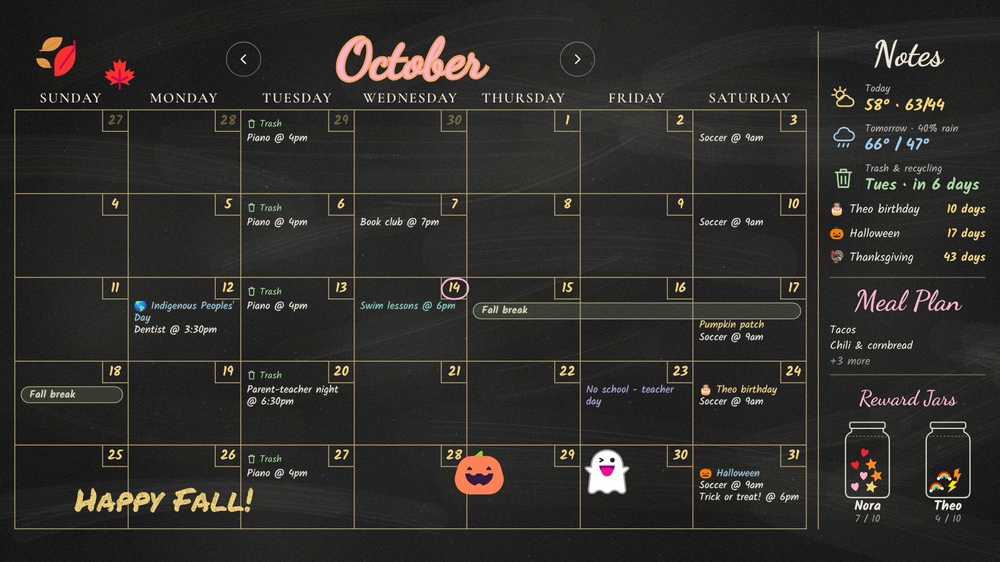
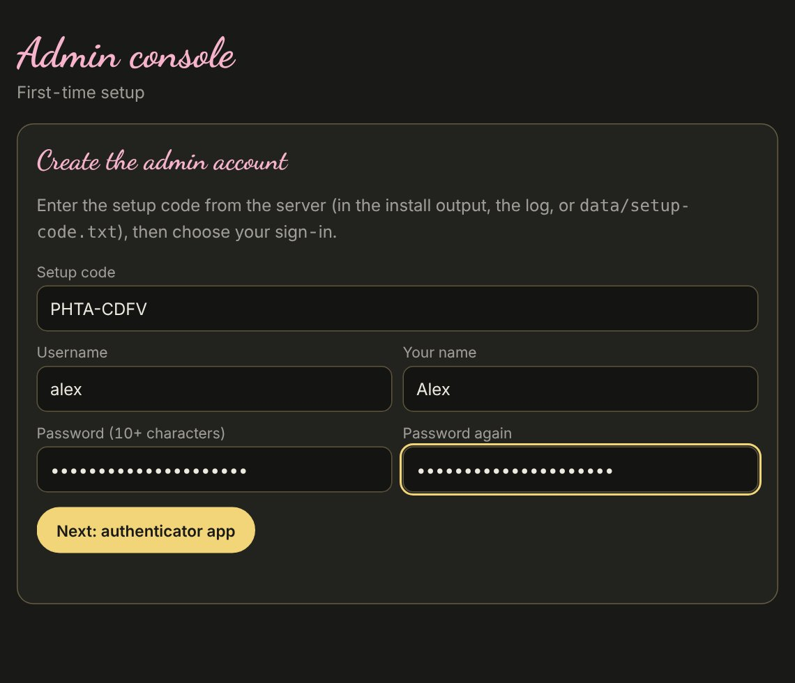
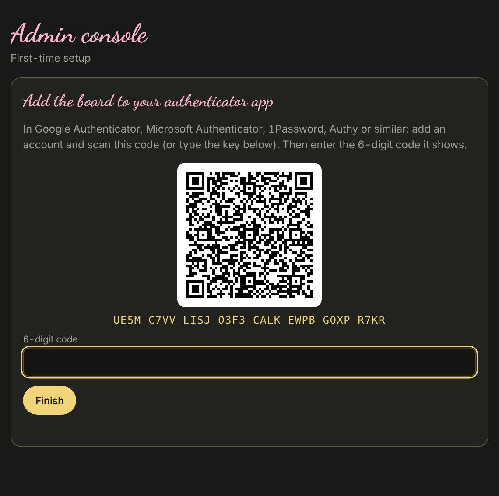
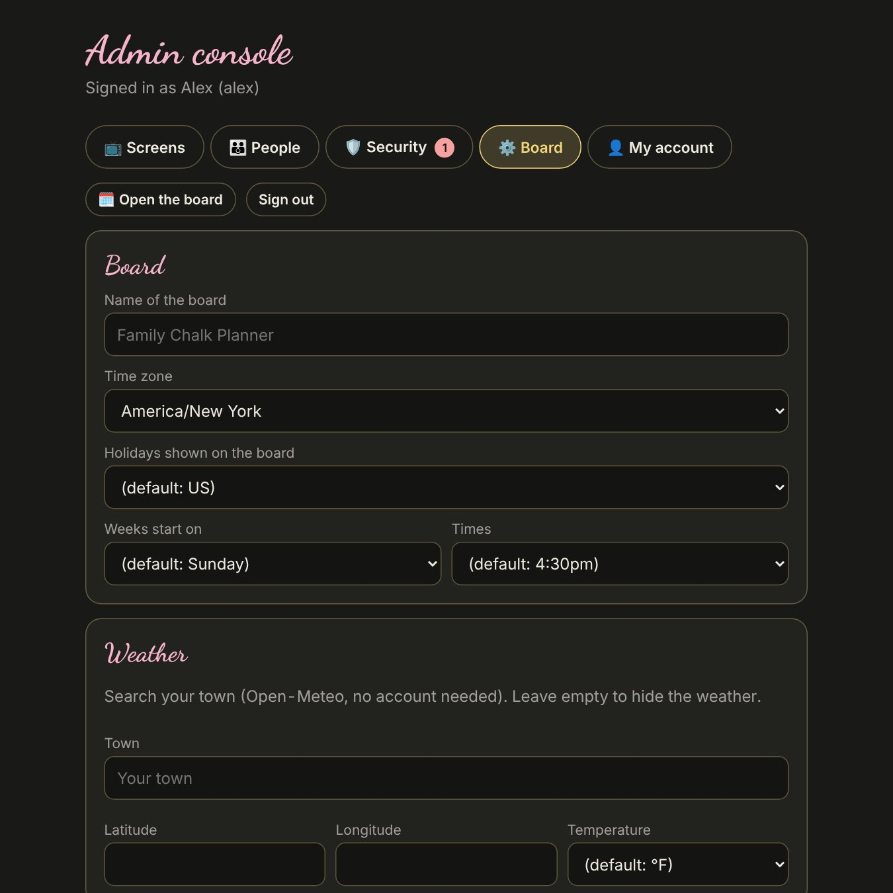
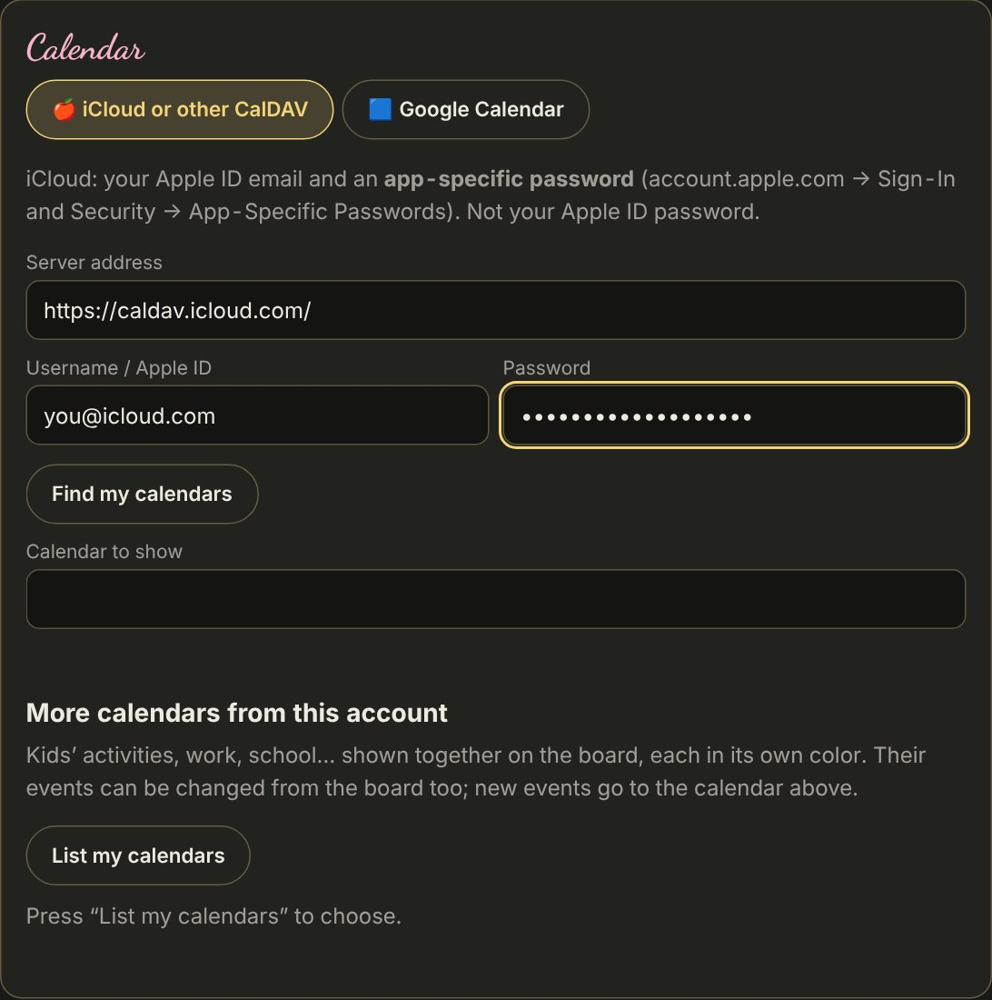
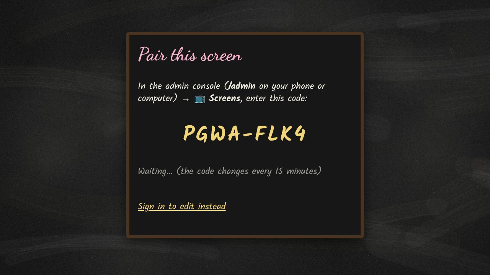
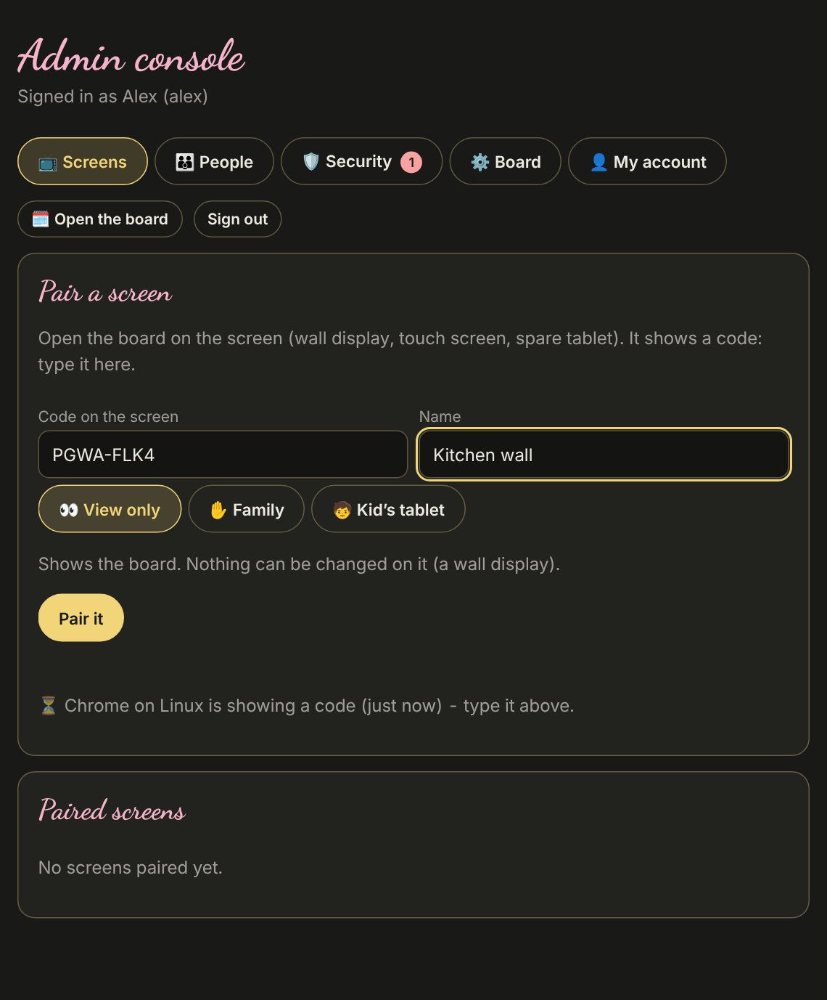
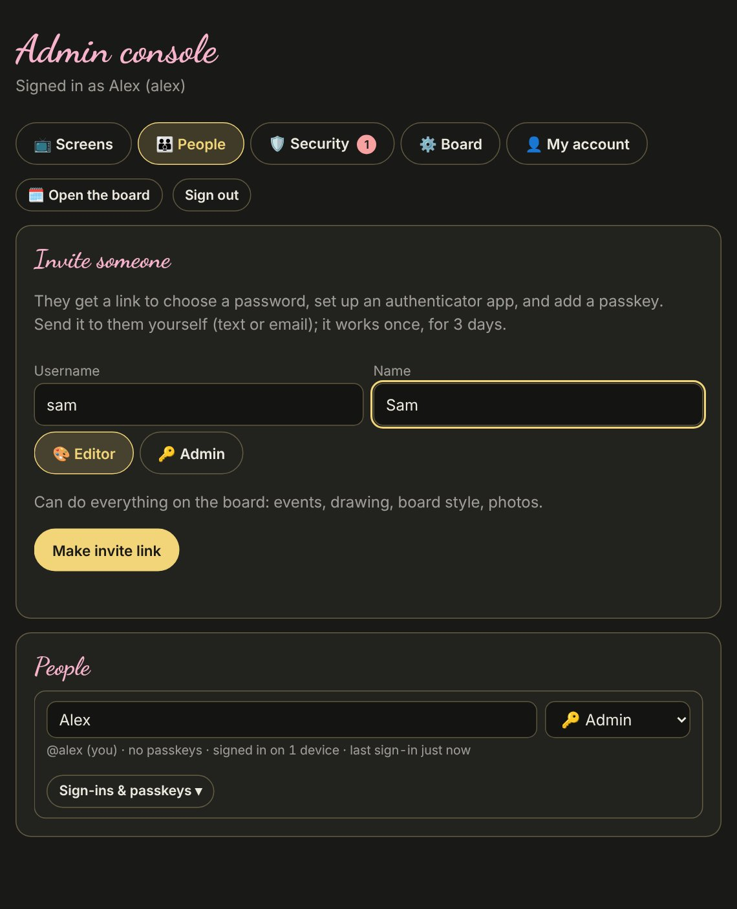

# Getting started

From nothing to your calendar on the wall, in about half an hour. Follow the steps in order; each one
says what you should see before you go on.



**What you'll end up with:** a screen on the wall showing your family's calendar on a chalkboard,
with weather, trash day, countdowns and a meal plan; a tablet (or phone) to add events and decorate
it; and an admin console where you add screens and people.

## What you need

- **A computer that's always on** to run the board. It needs very little: a Raspberry Pi 4 or 5, a NAS,
  an old PC, a mini PC, a Proxmox container, or the machine that already runs Home Assistant. No
  computer at home? A small cloud server works too ([cloud.md](cloud.md)).
- **A screen for the wall** with a web browser: an Android tablet or display (Fully Kiosk Browser is
  the easiest), a Raspberry Pi with a monitor, or a smart TV's browser.
- **Your calendar's sign-in** (every option: [calendars.md](calendars.md)):
  - **iCloud:** your Apple ID email and an *app-specific password* (step 3 shows where to get one).
  - **Google Calendar:** about 15 minutes of one-time setup ([google-calendar.md](google-calendar.md)).
  - **Nextcloud, Fastmail or any CalDAV calendar:** its address, username and password.
  - **Outlook or Microsoft 365, or just a calendar link** (school, sports team): works too, read-only.
- **An authenticator app** on your phone (Google Authenticator, Microsoft Authenticator, 1Password,
  Authy...) for the admin account.

## Step 1: Install it

Pick the one that matches what you have. Every way ends the same: the board running, and a one-time
**setup code** like `MJ3J-FKFW`.

| You have | Use | Time |
| --- | --- | --- |
| Home Assistant (OS or Supervised) | [A. The Home Assistant app](#a-home-assistant) | 5 minutes |
| Docker (a NAS, Unraid, a Pi, any server) | [B. Docker](#b-docker) | 5 minutes |
| Debian or Ubuntu, a Raspberry Pi, a Proxmox container | [C. Linux](#c-debian-ubuntu-raspberry-pi-or-proxmox) | 10 minutes |
| Nothing always on at home | [D. A small cloud server](cloud.md) | 30 minutes |

Home Assistant, Docker or Linux at home keep everything on your own network, and are the simplest to keep safe.
A rented server is someone else's computer: if you go that way, read
[what's on the server, and how to limit it](cloud.md#whats-on-the-server-and-how-to-limit-it) first.

### A. Home Assistant

1. In Home Assistant, go to **Settings → Apps**, tap **App store** (bottom right), open the **⋮**
   menu (top right) → **Repositories**, add `https://github.com/joshua-d-miller/family-chalk-planner-ha`, and close the
   dialog.
2. Find **Family Chalk Planner** in the list, tap it, then **Install**, then **Start**.
3. Open the app's **Log** tab. After about a minute you'll see:
   `no admin yet. Open /admin and enter the setup code ABCD-EFGH`.

The board is at `http://homeassistant.local:3002/` (or your Home Assistant's address, port 3002).
Home Assistant updates it and includes it in its backups; more in the app's **Documentation** tab.

### B. Docker

On the machine that will run it:

```bash
mkdir family-chalk-planner && cd family-chalk-planner
curl -fsSLO https://raw.githubusercontent.com/joshua-d-miller/family-chalk-planner/main/compose.yaml
docker compose up -d
docker compose logs board
```

The last command shows the setup code. Everything the board keeps goes in the `data` folder next to
`compose.yaml`; that's the folder to back up. More: [docker.md](docker.md).

### C. Debian, Ubuntu, Raspberry Pi or Proxmox

**On Proxmox,** first make a container: **Create CT** → unprivileged, a Debian 12 or 13 template,
1 core, 512 MB of memory, 4 GB of disk. Under **Options → Features**, turn on **nesting**. Start it
and open its console.

**On the machine** (Debian 12/13, Ubuntu 22.04/24.04, or Raspberry Pi OS **64-bit**), as root:

```bash
apt-get update && apt-get install -y git
git clone https://github.com/joshua-d-miller/family-chalk-planner.git /opt/family-chalk-planner
bash /opt/family-chalk-planner/deploy/install.sh
```

It takes a few minutes and ends with the board's addresses and the setup code:

```
Family Chalk Planner is installed (running from /opt/family-chalk-planner).
    Wall display:  http://192.168.1.20:3002/
    Setup code:    MJ3J-FKFW   (open http://192.168.1.20:3002/admin and create the admin account)
```

More (other folders, HTTPS, backups): [install.md](install.md).

## Step 2: Create the admin account

On a computer or tablet, open `http://<the board's address>:3002/admin`.

1. Type the **setup code**, choose a **username**, your **name**, and a **password** (10 or more
   characters). Tap **Next: authenticator app**.

   

2. In your authenticator app, add an account and **scan the QR code**. Type the 6-digit code it shows
   and tap **Finish**.

   

You're in the **admin console**. The setup code is used up; from now on you sign in with your
username, password and the authenticator code.

## Step 3: Connect your calendar

In the console, tap **⚙️ Board**.



1. **Board:** a name (shown on the screens), your **time zone**, which **holidays** to show, and
   whether weeks start on Sunday or Monday.
2. **Weather:** type your town and pick it from the list. Leave it empty for no weather.
3. **Calendar:**
   - **iCloud:** keep **iCloud or other CalDAV**. Server address `https://caldav.icloud.com/`,
     your Apple ID email, and an **app-specific password**: on
     [account.apple.com](https://account.apple.com), **Sign-In and Security → App-Specific
     Passwords → +**, name it "Chalk Planner", and copy the password it shows (not your Apple ID
     password).
   - **Nextcloud, Fastmail, other CalDAV:** its CalDAV address, your username and password (or an app
     password).
   - **Google:** tap **Google Calendar** and follow [google-calendar.md](google-calendar.md).
   - **Outlook or Microsoft 365:** the board can show it, read-only, as a calendar link (next step);
     [calendars.md](calendars.md#outlook-and-microsoft-365) shows where to find the link.

   Tap **Find my calendars** and pick the one to show. Under **More calendars from this account** you
   can add others (kids' activities, work), each in its own color.

   

4. **Calendar links** (optional): read-only links, like a school or team calendar.
5. **Photos** (optional): a shared album link, for the polaroids and the overnight slideshow
   ([photos.md](photos.md)).

Tap **Save and restart** at the bottom. The board restarts in a few seconds with your calendar.

## Step 4: Put it on the wall

1. On the wall screen, open `http://<the board's address>:3002/`. It shows a pairing code (it changes
   every 15 minutes).

   

2. In the console, **📺 Screens**: type the code, name the screen ("Kitchen wall"), pick what it may
   do, and tap **Pair it**. The wall shows your calendar a moment later.
   - **👀 View only:** shows the board. Right for a wall display.
   - **✋ Family:** a shared touch screen anyone in the house can use to add events and decorate.
   - **🧒 Kid's tablet:** opens on one kid's chores.

   

**Keeping the wall screen on the board:**

- **Android:** install [Fully Kiosk Browser](https://www.fully-kiosk.com/). Set the **Start URL** to the
  board's address, and turn on **Keep screen on** and **Start on boot**.
- **Raspberry Pi or a PC:** open the board full screen, e.g. `chromium --kiosk http://<address>:3002/`,
  and start it with the computer.

A paired screen stays paired, even after a restart or an update.

## Step 5: Invite the family

In the console, **👪 People**: a username, their name, and **Editor** (everything on the board) or
**Admin** (also the console and settings). Tap **Make invite link** and send it to them. The link
works once, for 3 days. They choose a password and set up their own authenticator app.



On their tablet or phone, they open `http://<address>:3002/edit`, sign in, and **add it to the home
screen** (Safari: Share → Add to Home Screen; Chrome: ⋮ → Add to Home screen). It then opens like an
app.

That's it: the board is up. The [user guide](user-guide.md) shows what every button does.

## Good next steps

- **An `https://` address and passkeys** (Face ID, Touch ID, fingerprint instead of codes): put the
  board behind a reverse proxy with a name, then enter that address in ⚙️ Board → **On your network**
  ([install.md](install.md#5-https-and-a-nice-name-recommended)).
- **Backups:**
  - **Home Assistant:** its own backups include the board.
  - **Docker:** back up the `data` folder.
  - **Linux:** back up the board's backup folder (`/opt/family-chalk-planner/data/backup` unless you
    chose another). The board writes a copy of its database there every night.
- **Updates:**
  - **Home Assistant:** tap **Update** on the app when it's offered.
  - **Docker:** `docker compose pull && docker compose up -d`.
  - **Linux:** admin console → ⚙️ Board → **Updates → Update now**, or turn on **Install updates by
    themselves**.
- **Chores, the meal plan and reward jars:** set them up from the tablet ([user guide](user-guide.md)).

## If something's not right

| What you see | What to do |
| --- | --- |
| The setup code doesn't work | It works once. Lost it or used it? Linux: `sudo /opt/family-chalk-planner/deploy/reset-admin.sh`. Docker: `docker compose exec -u 1000:1000 board node server/chalkboard.js --reset-admin`, then `docker compose restart`. Home Assistant: the app's **Reset the admin** option. Each prints a new code. |
| "Calendar unavailable" on the board | iCloud needs an **app-specific password**, not your Apple ID password. Check ⚙️ Board → Calendar, tap **Find my calendars** again, then **Save and restart**. |
| The wall screen keeps showing a pairing code | The code changes every 15 minutes; pair it with the one showing now. |
| Can't open the board from another device | Use the server's IP address and port 3002 (`http://192.168.1.20:3002/`); check the server's firewall allows port 3002. |
| The wall doesn't update until you reload it | A reverse proxy is buffering: turn off response buffering for the board ([install.md](install.md#5-https-and-a-nice-name-recommended)). |
| Handwriting looks like Comic Sans | The board's fonts didn't install. Linux: `sudo bash /opt/family-chalk-planner/deploy/update.sh`. |

Still stuck? Open an [issue](https://github.com/joshua-d-miller/family-chalk-planner/issues) with what you
did, what you saw, and the last lines of the log (Home Assistant: the app's **Log** tab; Docker:
`docker compose logs board`; Linux: `journalctl -u family-chalk-planner -n 50`).
